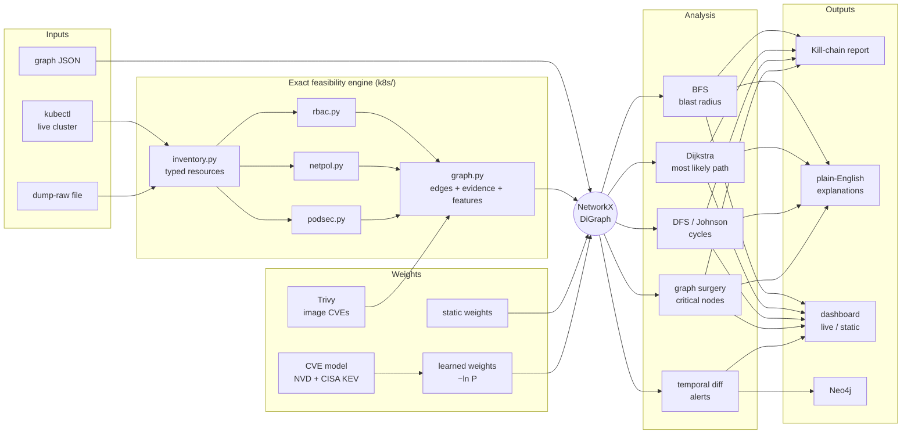
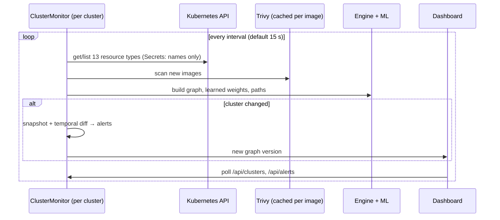

# KubeAttackViz — Kubernetes Attack Path Analysis

KubeAttackViz turns a Kubernetes cluster into an **attack graph** and answers the questions a
defender actually asks:

- *Which high-value targets (secrets, nodes, cluster-admin) can an attacker reach, and from where?*
- *What is the most likely path, and which single hop carries the uncertainty?*
- *Which one resource, if fixed, removes the most attack paths?*
- *Did the last change to the cluster make anything easier to reach?*

It works on live clusters (`kubectl`), on saved dumps, and on hand-written graph files. Edge
weights can be the classic hand-tuned values or **learned probabilities** from a model trained
on 361,825 real CVE records. A live dashboard monitors several clusters at once.

> Everything the tool does towards a cluster is **read-only** (`get` / `list`). Secret *values*
> are never fetched — only names and types.

---

## Contents

1. [Quick start](#1-quick-start)
2. [Live demo: three clusters](#2-live-demo-three-clusters)
3. [Architecture](#3-architecture)
4. [How the attack graph is built](#4-how-the-attack-graph-is-built)
5. [The four core algorithms](#5-the-four-core-algorithms)
6. [Risk model and mathematics](#6-risk-model-and-mathematics)
7. [Machine learning: learned edge weights](#7-machine-learning-learned-edge-weights)
8. [Datasets](#8-datasets)
9. [Natural-language explanations](#9-natural-language-explanations)
10. [Temporal analysis and alerts](#10-temporal-analysis-and-alerts)
11. [Validation against a real cluster](#11-validation-against-a-real-cluster)
12. [Command reference](#12-command-reference)
13. [Project layout](#13-project-layout)
14. [Limitations](#14-limitations)
15. [References](#15-references)

---

## 1. Quick start

**Requirements:** Python 3.10+, and for live clusters: [Docker](https://docs.docker.com/get-docker/),
[kind](https://kind.sigs.k8s.io/), [kubectl](https://kubernetes.io/docs/tasks/tools/) and optionally
[Trivy](https://github.com/aquasecurity/trivy) for image CVE scanning.

```bash
pip install -r requirements.txt
python main.py run-tests                                   # 31 built-in tests

# Analyse a sample graph
python main.py full-report -i mock-cluster-graph.json
python main.py --weights learned full-report -i mock-cluster-graph.json

# Analyse a live cluster (current kubectl context)
python main.py --weights learned --scan-images full-report -k
```

Open the browser view of any analysis:

```bash
python main.py --weights learned export-frontend -i mock-cluster-graph.json
cd visualizer && python -m http.server 8080               # http://localhost:8080
```

---

## 2. Live demo: three clusters

Three local [kind](https://kind.sigs.k8s.io/) clusters run the same small e-commerce application
with different security postures. Manifests: [`demo/clusters/`](demo/clusters).

| Cluster | Posture | Entry points | Nodes | Attack paths |
|---|---|---|---|---|
| `kav-dev` | Loose: one `platform-admins` binding gives the CI runner **and** developer `dev-bob` cluster-admin; privileged debug pod with the host filesystem; no NetworkPolicies; old images | internet, CI runner, dev-bob | 20 | 16 |
| `kav-staging` | Mixed: payments NetworkPolicy; CI can read every secret; on-call `edit` access | internet, CI runner, qa-alice, sre-carol | 19 | 11 |
| `kav-prod` | Hardened: Pod Security *restricted*, default-deny NetworkPolicies with explicit allows, no token mounts, break-glass exec only | internet, CI runner, sre-carol | 19 | 19 |

**For a presentation, use the interactive menu:**

```bash
./demo/present.sh
```

```
  #   CLUSTER      STATE      PODS   POSTURE
  1)  kav-dev      running    5      loose    cluster-admin CI + dev-bob, privileged pod, no NetworkPolicies
  2)  kav-staging  running    5      mixed    some NetworkPolicies, CI reads every secret, on-call edit
  3)  kav-prod     running    9      hardened PSS restricted, default-deny, no token mounts, break-glass only
```

Pick a cluster, then: **1** pods · **2** RBAC & NetworkPolicies · **3** ML attack-path analysis
(kubectl scan → pods → Trivy CVEs → ML edge weights → attack paths hop by hop → blast radius →
chokepoints) · **4** ML weight of every edge · **5** live monitor with a clickable dashboard link
that also opens in the browser (Ctrl+C returns to the menu) · **6** inject or revert a
misconfiguration. Missing clusters are created on demand.

Other entry points:

```bash
./demo/start.sh                 # create missing clusters → kitty (logs) + Chrome (dashboard)
./demo/start.sh dev             # one cluster   (or: ./demo/start.sh dev prod)
./demo/start.sh --here prod     # monitor in the current terminal instead of kitty
./demo/drift.sh prod admin-sa   # make a risky change → alert within one scan
./demo/drift.sh prod admin-sa revert
./demo/stop.sh                  # stop the monitor (clusters keep running)
./demo/teardown.sh              # delete the clusters
```

The terminal (kitty) shows the monitor log — each scan's `kubectl` summary and, whenever a
cluster changes, the top attack paths **hop by hop** with each hop's probability, where that
probability came from, the CVE evidence and the weakest link. Two more panes show pods across
clusters and live Kubernetes events. The browser shows the dashboard, which refreshes itself when
a cluster changes and pops up alerts.

Example of the monitor's reasoning for `kav-prod` (a compromised on-call credential):

```
▶ #2 CRITICAL risk 8.87/10  P(path)=98.5%   sre-carol → sre-carol-breakglass → ledger → ledger-creds
    1. sre-carol ─[bound_to]→ sre-carol-breakglass     P=0.995  config fact  (Subject of rolebinding sre-carol-breakglass)
    2. sre-carol-breakglass ─[can_exec]→ ledger        P=0.995  config fact  (exec_pods via role/breakglass-exec)
    3. ledger ─[mounts]→ ledger-creds                  P=0.995  config fact  (Secret volume reference)
    ↳ weakest link: hop 1 (P=0.995, config fact)
```

Every hop is decided by configuration, so the path is near-certain once the credential is stolen.
Paths from the internet instead pass through a `cve-model` hop (entering a workload), and the
learned exploitation probability of that workload's CVE becomes the weakest link.

Drift scenarios (configuration changes only; nothing is exploited):

| Scenario | Change |
|---|---|
| `admin-sa` | bind the `shop/frontend` ServiceAccount to cluster-admin |
| `open-payments` | delete the payments NetworkPolicies |
| `expose-redis` | expose `payments/redis` as a NodePort Service |

---

## 3. Architecture



Live monitoring (`serve`) runs one scanner thread per cluster:



---

## 4. How the attack graph is built

For a live cluster or a raw dump, every edge is created **only if the cluster's configuration
allows that transition**, evaluated with Kubernetes' own semantics:

| Edge | Exists when | Feasibility |
|---|---|---|
| internet → pod | a LoadBalancer / NodePort Service or an Ingress routes to the pod | conditional |
| pod → ServiceAccount | the SA token is auto-mounted (pod setting overrides SA setting) | exact |
| identity → binding → role | the identity is a subject, incl. `system:serviceaccounts[:<ns>]` groups | exact |
| binding → Secret / Pod / SA / Node / cluster-admin | RBAC grants read secrets, exec/attach, create pods or deployments, create tokens, impersonate, bind/escalate, `nodes/proxy` — with namespace scope, wildcards and `resourceNames` | exact |
| pod → Secret | volume or env reference | exact |
| pod → pod | NetworkPolicy allows ingress at the destination **and** egress at the source | conditional |
| pod → Node | the pod violates a [Pod Security Standards](https://kubernetes.io/docs/concepts/security/pod-security-standards/) *baseline* host-isolation control | exact if privileged, else conditional |

- **exact** — the configuration fully decides the transition.
- **conditional** — the configuration permits the attempt; success depends on something it
  cannot decide (an exploitable flaw in the target workload). Learned probabilities apply here.

Every edge stores its **evidence** (the object that makes it possible) and its **security
features** (privileged, root, capabilities, host access, token mount, exposure, NetworkPolicy
isolation, permission, wildcard use, binding scope, image CVEs).

**Entry points (sources):** the internet; every human `User` named in an RBAC binding
(a compromised credential); pods labelled `kubeattackviz.io/entry-point` (declared in the
manifests, e.g. a CI runner that executes third-party code).
**Targets (sinks):** Secrets, cluster Nodes, and cluster-admin-equivalent roles.

**Scoping.** By default the graph covers application namespaces and keeps only nodes that can be
on an attack path: system namespaces and `system:*` / `kubeadm:*` RBAC are excluded, bindings
that grant nothing sensitive are dropped, Services are folded into the edge they enable, and dead
ends are pruned. `--include-system` keeps everything (≈114 nodes instead of 15–20 on the demo
clusters).

---

## 5. The four core algorithms

Let $G=(V,E)$ be the directed attack graph, $S\subseteq V$ the sources and $T\subseteq V$ the sinks.

### 5.1 Blast radius — Breadth-First Search
*If node $s$ is compromised, what can be reached within $d$ hops?*
Standard BFS from $s$, recording each node at its first (shortest) hop distance; nodes are never
revisited, so every node appears in exactly one layer. Computed for every entry point **and** every
workload, ranked by the number of targets reached.
**Complexity:** $O(|V|+|E|)$ per origin.

### 5.2 Shortest (most likely) attack path — Dijkstra
For every pair $(s,t)\in S\times T$ the minimum-weight path

$$\pi^*(s,t)=\arg\min_{\pi:\,s\leadsto t}\ \sum_{e\in\pi} w(e).$$

With learned weights $w(e)=-\ln P(e)$ this is exactly the **most probable** path (see §6.2).
Paths are sorted most dangerous first.
**Complexity:** $O((|V|+|E|)\log|V|)$ per source.

### 5.3 Cycle detection — DFS / Johnson's algorithm
Elementary circuits via `networkx.simple_cycles` (Johnson's algorithm), deduplicated by rotating
each cycle to start at its smallest node. Dense RBAC graphs can contain astronomically many
cycles (cluster-admin can create a pod as any ServiceAccount, which loops back), so enumeration is
bounded: cycle length ≤ 8 and at most 200 cycles; the result says when it stopped early.
**Complexity:** $O((|V|+|E|)(c+1))$ for $c$ cycles.

### 5.4 Critical nodes — graph surgery
For every intermediate node $v\notin S\cup T$, remove it (logically) and measure what disappears:

$$\Delta(v)=N(G)-N(G\setminus v).$$

- $N$ = number of simple source→sink paths (≤ 15 edges) when counting fits a work budget
  (20,000 DFS expansions) — exact, and used for all sample graphs;
- otherwise $N$ = number of reachable $(s,t)$ pairs — polynomial, used for dense graphs.

The node with the largest $\Delta(v)$ is the best single fix. The output names the metric used.

---

## 6. Risk model and mathematics

### 6.1 Static mode (hand-tuned weights)
Edge weights are **attacker effort** (lower = easier). A CVE lowers the effort:

$$w'(e)=\max\bigl(0.1,\ w(e)\,(1-\tfrac{\text{CVSS}}{10})\bigr).$$

A path is dangerous when it is cheap **and** ends at a valuable target:

$$\text{risk}(\pi)=\frac{I_t}{1+C(\pi)/10},\qquad C(\pi)=\sum_{e\in\pi}w'(e),$$

where $I_t\in[0,10]$ is the target's impact. Severity: CRITICAL ≥ 7, HIGH ≥ 5, MEDIUM ≥ 3, else LOW.

### 6.2 Learned mode (probabilities)
Each edge gets a traversal probability $P(e)$ and weight

$$w(e)=-\ln P(e)\quad\Longrightarrow\quad \sum_{e\in\pi}w(e)=-\ln\prod_{e\in\pi}P(e).$$

Minimising total weight therefore **maximises the path's success probability**, and

$$P(\pi)=e^{-C(\pi)},\qquad \text{risk}(\pi)=I_t\cdot P(\pi)\ \ (\text{expected impact}).$$

Severity bands for expected impact: CRITICAL ≥ 4, HIGH ≥ 1.5, MEDIUM ≥ 0.5, else LOW.
Probabilities are clipped to $[0.01,\,0.995]$ so weights stay finite.

Where $P(e)$ comes from (reported per edge as its *basis*):

| Basis | When | $P(e)$ |
|---|---|---|
| `exact-config` | configuration decides the transition | $0.995$ |
| `cve-model` | conditional edge with a known CVE | $1-(1-p_u)(1-p_x)$ |
| `scenario-param` | conditional edge, no known CVE | $p_u$ |
| `legacy-prior` | hand-made graph JSON without feasibility information | per-category prior |

$p_x$ is the **learned** exploitation probability of the CVE (§7). $p_u$ (`--p-unknown`,
default 0.05) is the chance of getting across with no known vulnerability — an explicit
assumption, not a measured rate. The combination treats a known CVE as an independent second
way across, so a CVE can only raise $P(e)$.

### 6.3 Other scores
- **Advanced path score:** $0.7\cdot\text{risk}+0.3\cdot\max\text{CVSS}$.
- **Node risk amplification:** $r'_v=r_v\,(1+\log_2(1+k_v))$, where $k_v$ is the number of
  attack paths through $v$.
- **Node risk (static ingestion):** $r=\frac{L}{10}\cdot I$ with likelihood $L$ and impact $I$.

---

## 7. Machine learning: learned edge weights

**Task.** Predict $p_x=P(\text{CVE is exploited in the wild})$.
**Label.** 1 if the CVE is in the [CISA Known Exploited Vulnerabilities catalog](https://www.cisa.gov/known-exploited-vulnerabilities-catalog).
**Data.** 361,825 NVD CVE records (2010–2026), 1,743 known exploited (0.48 %).

**Features** (identical code at training and inference time, [`ml/cve_features.py`](kube_attack_viz/ml/cve_features.py)):
CVSS v3 base metrics (attack vector, complexity, privileges, user interaction, scope, C/I/A) —
CVSS v2 as fallback; base, exploitability and impact scores; CWE; reference tags (public exploit,
patch, vendor advisory); description keywords (remote code execution, authentication bypass,
deserialization, …); vendor popularity; publication year.

**Leakage guards.** Removed because they are consequences of a CVE being added to KEV:
`cisaExploitAdd` and other CISA fields, references to cisa.gov, `vulnStatus`, `lastModified`.

**Model.** Gradient-boosted trees (scikit-learn `HistGradientBoostingClassifier`, log-loss).
Post-hoc isotonic/sigmoid calibration was tested and rejected: it inflated predictions about 5×
and scored a worse Brier score than predicting the base rate.

**Evaluation — temporal split** (train on CVEs up to 2023, test on 2024+):

| Model | ROC-AUC | PR-AUC | Brier | Precision@100 |
|---|---|---|---|---|
| CVSS base score only | 0.770 | 0.012 | 0.00312 | 0.05 |
| Logistic regression | 0.877 | 0.112 | 0.00297 | 0.48 |
| **Gradient boosting (deployed)** | **0.887** | 0.108 | **0.00296** | **0.54** |
| FIRST EPSS *(reference; scored with hindsight)* | 0.975 | 0.428 | 0.00303 | 0.89 |

Out-of-fold, all years (5-fold): ROC-AUC 0.937, PR-AUC 0.310. Of the deployed model's 100
highest-scored 2024+ CVEs, 54 were really exploited, versus 5 for CVSS alone.

**Inference order** for a CVE on an edge or on the workload it enters: on KEV → 0.99;
out-of-fold score (never in-sample) for the 361,825 known CVEs; NVD record (`--online-cve`);
CVSS score only; no data.

**Image CVEs.** With `--scan-images`, every pod image is scanned with
[Trivy](https://github.com/aquasecurity/trivy) (cached per image); its CVEs are ranked by $p_x$ and
the top ten are attached to the pod.

Model card with data hashes: [`kube_attack_viz/ml/artifacts/MODEL_CARD.md`](kube_attack_viz/ml/artifacts/MODEL_CARD.md).
Retrain: `python main.py ml-fetch-data && python main.py ml-train` (≈105 MB download, ≈2 min).

---

## 8. Datasets

| Dataset | Used for | Link |
|---|---|---|
| CISA Known Exploited Vulnerabilities (KEV) | training labels; KEV entries get $p_x=0.99$ | [catalog](https://www.cisa.gov/known-exploited-vulnerabilities-catalog) · [JSON feed](https://www.cisa.gov/sites/default/files/feeds/known_exploited_vulnerabilities.json) |
| NIST National Vulnerability Database (NVD) | training features (CVSS, CWE, references, descriptions) | [nvd.nist.gov](https://nvd.nist.gov/) · [API 2.0 docs](https://nvd.nist.gov/developers/vulnerabilities) |
| NVD JSON data feeds (Fraunhofer FKIE mirror) | the yearly NVD files actually downloaded | [github.com/fkie-cad/nvd-json-data-feeds](https://github.com/fkie-cad/nvd-json-data-feeds) |
| FIRST Exploit Prediction Scoring System (EPSS) | external benchmark only (never a feature) | [first.org/epss](https://www.first.org/epss/) · [daily scores](https://epss.empiricalsecurity.com/epss_scores-current.csv.gz) |
| Trivy vulnerability database | image CVEs at analysis time | [aquasecurity/trivy](https://github.com/aquasecurity/trivy) · [trivy-db](https://github.com/aquasecurity/trivy-db) |
| Kubernetes Pod Security Standards | definition of host-access controls | [kubernetes.io](https://kubernetes.io/docs/concepts/security/pod-security-standards/) |

Every download is recorded in `data/raw/manifest.json` with URL, size, SHA-256 and time.
`data/` is gitignored; the trained model and the out-of-fold score table (1.8 MB) ship in
`kube_attack_viz/ml/artifacts/`, so `--weights learned` works without retraining.

---

## 9. Natural-language explanations

**CLI (`nlp_explainer.py`)** — template-based generation: each relationship maps to a verb phrase
and each resource type to an article ("the ServiceAccount", "the external actor"). Output: an
opening sentence (who reaches what in how many steps), the attack categories, a step-by-step
chain with CVE context, and the risk score. Chokepoints get a return-on-fix explanation.

**Browser (`nlp-engine.js`)** — a local query bar ("How can internet reach production-db?",
"Explain chokepoints"):

1. **Tokenise** the question (hyphenated resource names stay one token).
2. **Intent detection** — each token is compared with keyword lists for five intents (chokepoint,
   blast radius, cycle, CVE, reach target) by string similarity

$$\text{sim}(a,b)=\begin{cases}1 & a=b\\ 0.88 & a\subset b\ \text{or}\ b\subset a\\ 1-\dfrac{\text{lev}(a,b)}{\max(|a|,|b|)} & \text{otherwise}\end{cases}$$

   with Levenshtein distance $\text{lev}$; an intent fires above 0.75.
3. **Entity resolution** — the best-matching node name across all tokens (threshold 0.58).
4. **Answer** — the matching attack path, blast radius or chokepoint, rendered as an executive
   summary, hop-by-hop traversal, reasoning and remediation.

Everything runs locally; no external language model is used.

---

## 10. Temporal analysis and alerts

Snapshots are compared per **(source, sink) reachability**, not per exact route:

| Change | Meaning | Alert |
|---|---|---|
| new | a target became reachable | `NEW_ATTACK_PATH` |
| changed, risk ↑ | already reachable, now **easier** | `ATTACK_PATH_ESCALATED` |
| changed, risk ↓ | re-routed | `ATTACK_PATH_REROUTED` (info) |
| removed | no longer reachable | `ATTACK_PATH_ELIMINATED` (info) |

Also: new high-value nodes, new privilege edges, removed security controls, and attack-surface
growth. A causal attribution names the added nodes and edges that enabled each new or easier
path. Diffs can be exported to Neo4j (`--neo4j-uri`).

---

## 11. Validation against a real cluster

The feasibility engine is checked against a real API server and network plugin in a local kind
cluster ([`kube_attack_viz/lab/`](kube_attack_viz/lab)). Configurations are randomized; **every
label is measured**:

| Check | Ground truth | Engine |
|---|---|---|
| RBAC | [SubjectAccessReview](https://kubernetes.io/docs/reference/access-authn-authz/authorization/#checking-api-access) — the API server's own authorizer | `k8s/rbac.py` |
| Network | HTTP request executed inside the source pod | `k8s/netpol.py` |
| Token | projected token volume injected by admission | `k8s/podsec.py` |

Results (26 scenarios, Kubernetes v1.37, kindnet):

| Check | N | Precision | Recall | F1 |
|---|---|---|---|---|
| RBAC | 21,019 | 1.000 | 1.000 | 1.000 |
| Token mounting | 190 | 1.000 | 1.000 | 1.000 |
| Network, no host-network pod | 1,050 | 1.000 | 1.000 | 1.000 |
| Network, involving a host-network pod | 166 | 0.873 | 0.605 | 0.715 |

All 55 disagreements involve pods with `hostNetwork: true`. NetworkPolicy does not select such
pods, and their traffic leaves from the node's IP, so pod and namespace selectors do not match it;
the engine currently treats them like ordinary pods. This is a known limitation (§14).

```bash
kind create cluster --name kav-lab
python main.py lab-run --scenarios 25 --seed 7
python main.py lab-report
```

The harness refuses any kubectl context that is not a local `kind-*` cluster. Probes check
authorization decisions and HTTP reachability only.

---

## 12. Command reference

Global options go before the command, e.g. `python main.py --weights learned full-report -k`.

| Global option | Effect |
|---|---|
| `--weights static\|learned` | edge weights (default static) |
| `--scan-images` | scan pod images with Trivy |
| `--p-unknown P` | assumed foothold probability without a known CVE (default 0.05) |
| `--include-system` | keep system namespaces, system RBAC and dead-end nodes |
| `--online-cve` | fetch NVD records for CVEs not in the shipped score table |

| Group | Commands |
|---|---|
| Core analysis | `full-report` · `blast-radius` · `shortest-path` · `cycles` · `critical-node` · `graph-info` |
| Advanced | `classify` · `rbac-audit` · `explain` · `node-risk` |
| Data | `export-graph` · `export-frontend` · `dump-raw` |
| Temporal | `diff` · `watch` · `temporal-snapshot` · `temporal-history` |
| Live | `serve` |
| Machine learning | `ml-fetch-data` · `ml-train` · `ml-edges` · `ml-info` |
| Validation | `run-tests` · `lab-run` · `lab-report` |

Inputs: `-i graph.json` (graph JSON or a `dump-raw` file) or `-k` (live cluster). Full examples:
[`COMMANDS.md`](COMMANDS.md).

---

## 13. Project layout

```
kube_attack_viz/
├── algorithms/          bfs.py · dijkstra.py · dfs.py · critical_node.py
├── k8s/                 exact feasibility engine: inventory · rbac · netpol · podsec · graph
├── ml/                  datasets · cve_features · cve_model · techniques · weights · model_card
│   └── artifacts/       trained model, KEV ids, out-of-fold scores, MODEL_CARD.md
├── lab/                 controlled experiments: scenarios · groundtruth · runner · report
├── ingestion.py         graph JSON, raw dumps, kubectl (Secrets: metadata only)
├── graph_builder.py     NetworkX graph, static/learned weights
├── scanners.py          Trivy integration
├── live.py              multi-cluster monitor + dashboard API
├── temporal.py          snapshots, diffs, alerts, Neo4j export
├── classifier.py · rbac_analyzer.py · node_risk.py · remediation.py · nlp_explainer.py
├── report_generator.py · frontend_export.py · cli.py · test_runner.py
visualizer/              dashboard (D3.js): graph, dashboard, timeline, NLP query bar
demo/                    three demo clusters, start/stop scripts, drift scenarios
deploy/scanner-rbac.yaml least-privilege read-only scanner identity
```

---

## 14. Limitations

- **Host-network pods:** NetworkPolicy semantics for `hostNetwork: true` pods are not modelled
  (§11).
- **`p_unknown`** (foothold without a known CVE) has no public measurement; absolute path
  probabilities scale with it. Sweep it with `--p-unknown` to see which conclusions depend on it.
- **CISA KEV** is a lower bound on exploitation, so learned probabilities are conservative.
  Recent CVEs have had less time to be added (label lag).
- **Trivy** matches OS and language packages; software compiled from source inside an image is
  not identified.
- **NetworkPolicy** is assumed to be enforced by the network plugin. `ipBlock` peers, admission
  webhooks, aggregated ClusterRoles (read as materialised by the API server) and
  `nonResourceURLs` are not modelled.
- **Local clusters:** in the demo, "internet exposure" means NodePort on the local machine.

---

## 15. References

- Kubernetes documentation — [RBAC](https://kubernetes.io/docs/reference/access-authn-authz/rbac/),
  [Network Policies](https://kubernetes.io/docs/concepts/services-networking/network-policies/),
  [Pod Security Standards](https://kubernetes.io/docs/concepts/security/pod-security-standards/),
  [Pod Security Admission](https://kubernetes.io/docs/concepts/security/pod-security-admission/),
  [Authorization / SubjectAccessReview](https://kubernetes.io/docs/reference/access-authn-authz/authorization/)
- [CISA Known Exploited Vulnerabilities catalog](https://www.cisa.gov/known-exploited-vulnerabilities-catalog)
- [NIST National Vulnerability Database](https://nvd.nist.gov/) and [CVSS specification (FIRST)](https://www.first.org/cvss/)
- [FIRST EPSS](https://www.first.org/epss/)
- [Trivy](https://github.com/aquasecurity/trivy) · [kind](https://kind.sigs.k8s.io/) · [NetworkX](https://networkx.org/) · [scikit-learn](https://scikit-learn.org/) · [D3.js](https://d3js.org/)
- D. B. Johnson, "Finding all the elementary circuits of a directed graph", *SIAM J. Computing*, 1975.
- E. W. Dijkstra, "A note on two problems in connexion with graphs", *Numerische Mathematik*, 1959.
- Design inspiration (independently implemented): [KubeHound](https://github.com/DataDog/KubeHound),
  [IceKube](https://github.com/WithSecureLabs/IceKube), [rbac-tool](https://github.com/alcideio/rbac-tool)

This project is provided as-is for educational and security-analysis purposes.
